# Sobre el Autor y el Proyecto

Bajo el seudónimo **A Glimpse of Light** (*Un Destello de Luz*), este proyecto nace no del deseo de protagonismo personal, sino de una profunda necesidad de tender un puente luminoso entre dos mundos que durante siglos parecieron distantes: **la ciencia de vanguardia y la sabiduría espiritual del Cristo**.

A Glimpse of Light viene de "A Glimpse of Light into the Darkness" que en castellano significa "Un Destello de Luz en la Oscuridad" un pseudónimo bajo el cual el hijo de Maria Paz Arés Osset ha publicado desde 2011 ideas que pretenden como el propio pseudónimo dicta ser un destello de esperanza en una Humanidad abocada al abismo en una permanente oscuridad de la Codicia y el ego.

Por un lado tengo claro que no quería que ninguna falla mía, como hombre muy imperfecto y criticable manchase ideas trascendentes. Por otro lado está el miedo al qué dirán, familiares, amigos, la sociedad, siempre dispuesta a targuetear su odio ante ideas nuevas y particularmente revolucionarias.

Pero justo en esta obra expongo la importancia de la Alta Vibración y el miedo no tiene cabida en esa vibración, por lo tanto sí Yo soy el que ha escrito y creado todas las ideas. Pero no os perdáis en Yo el hombre imperfecto sino en Yo una parte trascendente que todos tenemos y que no puede nominarse, y este es el mayor miedo que me ha impedido mirar de frente al mundo pero llegados a este punto crítico, quien quiera ver que vea.

Sobre mí destacar que la Vida me ha traído a este momento. Ya de pequeño sabía que me tocaba decir algo, no sabía qué. De muy pequeño pensaba en qué pasaría si dentro de una cueva con un cuadro de mando pudiéramos introducirnos en la vida de otro hermano humano aleatorio, hoy cuando veo Tik Tok o Instagram veo un pensamiento materializado. Recuerdo dibujar en un papel la que fue la mascota Naranjito que no sé por qué no se me nombró. Recuerdo también leer investigaciones sobre la melatonina que me llevaron a experimentarla y ser consciente de la calcificación de la glándula pineal en la mayoría de los humanos para la que ahora con mi madre tengo el proyecto saludequilibrio.es que pretenderá en última instancia conectar con la Salud que es otra expresión de Alta Vibración frente a la Enfermedad. No puedo olvidar cuando el consejero español de España en México me trajo de México el libro definitivo sobre investigadores de la hormona melatonina. Es como si todo se alinease de forma aleatoria.

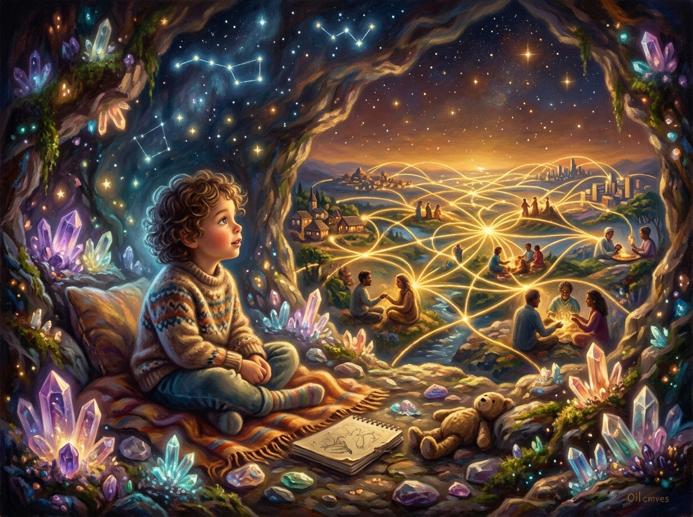

Siempre he sido un chico muy imperfecto en la apariencia si bien siempre sabía que cada uno a su manera es Perfecto porque es una nota más de la sinfonía del Cosmos. No he citado a nadie con esto, pero me viene a la cabeza uno de mis maestros con los que últimamente hago formaciones poco convencionales pero cada vez más de moda, el sabio doctor Jorge Carvajal, un genio de Medellín al que citaremos en el proyecto de salud, pues no es necesario reinventar la rueda si tenemos ya un maestro de orquesta de tal calibre en el planeta, os aconsejo su web unalma.com que mantiene su amable hijo Sebastián. 

Pero nadie está de más, el más miserable humano está en el momento adecuado en nuestra vida para darnos una importante lección de miseria y dolor. 

En el colegio e instituto me empeñaba en sacar las mejores notas porque pensaba que de esa manera conseguiría destacar, muy en lo material, y lo conseguí y también en la Universidad donde en un ejercicio de masoquismo saqué Ingeniería Superior de Telecomunicaciones, y un máster de Energía y Medio Ambiente, y un máster de Big Data, y un largo etcétera de cosas y cosas y cosas, pero cuanto más acumulaba no sentía completitud y asimismo ahora creo que gracias a Dios tampoco me supuso ganar dinero.

He vivido vida de rico, vida de pobre, grandes superaciones personales y como en "La Vida es Sueño" esto nos lleva a veces a no saber quiénes somos, pero si lo trascendemos nos da la potencia de saber que no somos nada. Esa trascendencia del Ego en el fondo exhuma en cada palabra de "Mi Amigo Jesucristo"

En 2010 pude vivir en un mismo año vida elitista en New York, como me llamaba Diego el doorman de 230 5th "The King of the Jungle" y en diciembre en Madrid tras un concierto de Cuencos Tibetanos de Nieves Canta acercarse una amiga de ella y hablarme de mi aura y advertirme de que iba a vivir cosas horribles, que me repondría y defendería cosas importantes para el Mundo. Me lo dijo sin dudar y me sentí como si llevara tiempo esperándola. 

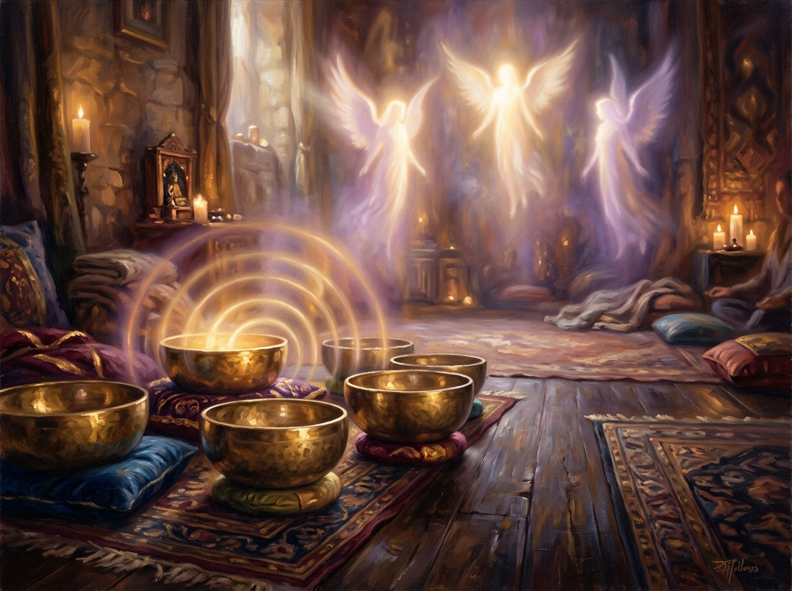

Pero tampoco sabía todo lo que era horrible, perdí todo lo que representaba mi Ego, dinero, poder, amistades, familia, salud ... el león herido, pero siempre sentía cientos de ángeles alrededor, de alguna forma se comunicaron para que diera ciertos pasos para que recuperase una economía mínima pero estable frente al gigante con pies de barro que había sido. Y mi madre, Paz, un verdadero faro, siempre pionera, cuando le veía hacer yoga lo veía raro luego me hice fan del yoga, y así con todo, con la educación, con la religión. Siempre una inspiración y un apoyo, un roble en los momentos difíciles que uniendo mi visión estratégica permitió surfear la ola desde una felicidad casi impensable con una tormenta borrascosa. 

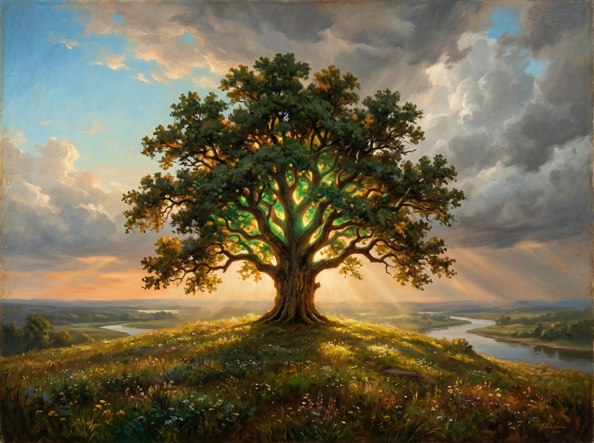

Ya en 2010 así se me dijo que sería y así ha sido. Tanto este libro como toda la obra artística ya sea mía o de mi madre, no tienen un fin de lucro financiero. Mónica de las Heras en Biocultura 2025 me dijo que quitase la parte económica de cualquier libro así como que había sido general de ejércitos en el siglo 11, por qué no, ni entro ni salgo. Días más tarde nadando en la piscina de la Universidad en la imparto un poco de habilidades técnicas a estudiantes con experiencia laboral en cualquier sector me vino a la cabeza el libro. Parte de la génesis está en el hecho de querer implantar en la cabeza de mi madre la idea del perdón tras una durísima etapa de bloqueo hereditario con sus hermanas. El perdón es clave, si te roban te quitan tu dinero, si te matan te quitan tu vida, pero si no perdonas tú mismo te quitas muchas vidas porque el cielo o el infierno no son lugares sino estados de vibración de nuestra consciencia y el enfado tiene un karma largo si no se corta de raíz, ahora que estoy escribiendo un libro sobre el karma, es una idea que me dio otro de esos seres que en un momento me han echado un capote en este caso en forma de libro de un grupo budista llamado Kadampa con el que mi madre tiene cierta conexión y curiosamente cuando fuimos a verles a su sitio en el Boalo allí estaba un antiguo compañero de Capoeira, de darnos golpes asesinos a hablar del ayuno y sus bondades para la salud y la mente.

Pero mucha de la génesis también está en el nadar en una Universidad que gira en torno a la figura de Jesucristo absolutamente, al lado de una iglesia esférica preciosa en la que doy las clases bajo la atenta mirada de Jesucristo y podría decir que cada alumno es un milagro como en pocos meses han transformado de esa manera sus habilidades. 

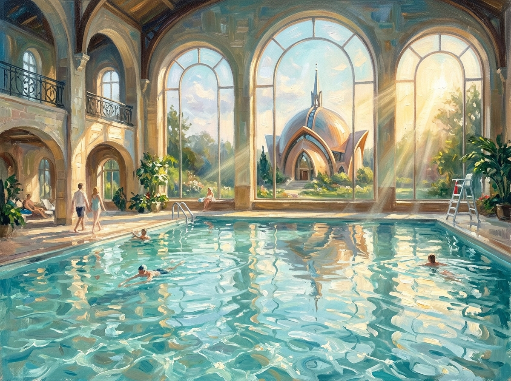

El padrenuestro me resonaba y entre largo y largo pensaba que en el fondo todas las frases son una sintonía que se autocomplementan, básicamente cuando hablamos de no nos dejes caer en la tentación parte de ello sería no nos dejes tener enfado y salir de la energía del perdón, que es un poco la frase "perdona las ofensas ... como nosotros perdonamos" esa redundancia es una forma de matizar que entre todas las tentaciones la tentación de la ira, la hiel para con nuestros hermanos permanente sería especialmente dañina. La parte final está relacionada pero con las tentaciones de otros, es casi pedir protección contra aquel que ha caído en la tentación. Por ejemplo si alguien se enfada por algo que hicimos con o sin intención y esta persona no lo suelta, entonces esa emoción atrapada genera una cadena de acontecimientos energéticos que tras haber estudiado Shiatsu veo que la Medicina Tradicional China trata de describir la cadena de causas efectos energéticos que se acaba manifestando en una enfermedad que oh cuanto mejorará la Medicina occidental moderna cuando abrace esta medicina aparentemente primitiva y ambas se complementen.

Pero esto no se para aquí, aquel quien no soltó el enfado se destroza a sí mismo pero emite ondas de pensamiento que impactan en la persona odiada en este caso. El famoso mal de ojo ni siquiera ha de ser intencional, basta con no soltar una emoción y la oración acaba con una protección contra el Mal, quién si no el Demonio nos tentaría a instalarnos en las bajas vibraciones. 

En cualquier caso esta serie de pensamientos fueron génesis de este libro que necesitaba ser escrito para simplificar todo en aquel verso de San Pablo "Si no tengo Amor no soy Nada" casi te diría, lector, puedes olvidarte de todo lo demás y poner de mantra "lo hago con Amor" y te irá bien.

En el libro que ando escribiendo estos días sobre el Karma TODO gira en torno a esta idea "Si no tengo Amor..." el karma es tan sencillo como la tercera Ley de Newton pero esta acción reacción tiene un ingrediente que lo impregna todo: "Lo hiciste con Amor o sin Amor" 

Y es curioso porque después de la ingeniería pasé tiempo leyendo libros de economía y finanzas que no me divertían pero me decía algo dentro de mi que los necesitaba, en 2010 tras el estreno de "Inside Job" me quedó clara la debilidad del sistema financiero y cuando estaba en la piscina de una fiesta de esas épicas en casa de Carol rodeado de persona que por un motivo u otro estaban cerca aunque ellos manejaban grandes fondos de inversión mientras yo en el fondo era un "sobrino de" de cara a la galería, y allí en Mallorca tras volver de New York sabía que debería empezar a escribir algo al respecto, por un lado Nueva York me había dado un pensamiento más abierto pero por otro me daba ganas de ser importante y desde esa idea en esa conversación en la piscina nació la idea de hacer un blog que se llamara "A Glimpse of Light into the Darkness"

Al año siguiente en 2011 al ver el documental "Home" me di cuenta que ni finanzas ni medio ambiente que el problema estaba en el uso de los recursos, se lo comuniqué a Javier Cendra por aquel entonces en Londres y me obsesioné por la sostenibilidad y la RSC, recuerdo hablar de los basureros y el reciclaje con Carlos Bousoño que era en aquel entonces cabeza de la fabricación de basureros modernos a nivel mundial después de haber liderado RSC en Abengoa. Pero siempre me veía un punto por arriba y me imponía que debiera generar ideas para inspirar a amigos que ya están en posiciones de influencia como Carlos o Javier y puse algunos artículos sobre sostenibilidad en el blog.

Llegó el 15 de Mayo de 2011 a Madrid y vi ese espíritu de cambio que aunque luego los políticos lo ensuciasen en su origen tuvo gente pura... me comentó alguien en el rato que estuve allí que pusiera alguna idea para aportar y como una metainspiración me hizo dar la idea de que la Gobernanza fuera compartida sin dar carta blanca a nadie para gobernar cuatro años. Esto de vuelta a New York hablando con la cantante Dana Fuchs y sus amigas me preguntaron por el 15M y me salió decir el caos político que supone votar a alguien por una idea A que defiendes y una B que detestas... claramente el diseño era malo. Mi amigo Edu de vuelta a Madrid me dijo que en Suiza había un sistema bien establecido que salvaba el fallo y me lo estudié bien antes de escribir mi artículo de Democracia.

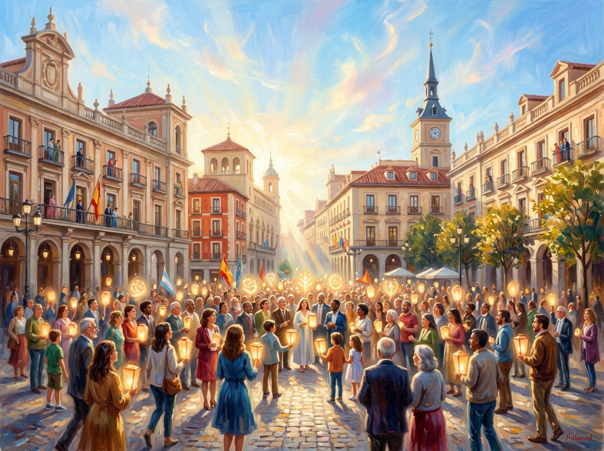

Siempre desde entonces he pensado que necesitaba sacar esa idea a la luz pero la falta de tiempo y estar en el barro y el Miedo a quien no quiere cambiar el sistema me retenía. Entonces llegaron los modelos LLM y desde entonces tengo en la cabeza que con esa ayuda podría hacer una edición buena de mi artículo en forma de libro. No pretendo jamás criticar el sistema actual sino estar en el agradecimiento de que nos ha traído hasta aquí en circunstancias geopolíticas y que un sistema de toma de decisiones mejorado podrían salvar a la Sociedad.

Entre medias, vi que mi madre estuvo durmiendo en la calle el 15M y en una reunión con unos gnósticos se preocupó ante una posible caída de la Humanidad, pero me gustó mucho la respuesta del gnóstico diciendo que "si la Humanidad ha decidido extinguirse lo hará y que nuestra única forma es nosotros cambiar y tratar de inspirar al resto". 

De hecho últimamente me fijo mucho en que mi madre se llama Paz Arés y hace cuadros llenos de fuego que puedes ver en pazaresosset.es y que tiene esa dualidad de máxima paz con máximo fuego que le lleva a tener enfado, desesperación y similares emociones de tentación de las cuales nadie estamos exentos.

Pero traigo esto a colación porque le suelo decir que el día que Paz gane a Arés (parecido al dios de la guerra) y ella haga cuadros con colores calmados quizás entonces hay esperanza para la Humanidad pues cada vez tengo más claro el "Como es Arriba es Abajo" del Kybalion o la fractalidad que hace que toda la información esté contenida en todo. Y en el fondo del todo ha sido la gran inspiración de este libro que ha supuesto para mi un salto de claridad.

Casualmente mientras escribo estas líneas pensando en la publicación del libro en kdp mi madre acaba de hacer un cuadro así que voy a poner.

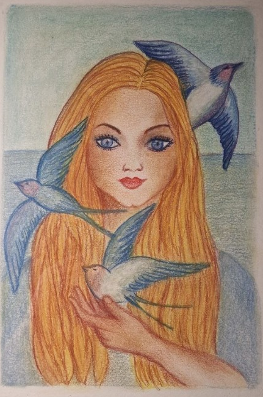

Quiero que esté claro que mientras el libro busca subir la frecuencia de la humanidad al Amor el publicarlo podría generar beneficio económico, y no quiero ver en esto nada incongruente, me comprometo a usar cada euro que genere este libro en el proyecto pazaresosset.es y saludequilibrio.es haciendo más libros y poniendo más horas en hacer y promover las ideas clave.

En su momento estaba en lo material y lo material será publicado en el libro de Democracia, pero la vida me ha hecho aprender que la clave de la Democracia es este libro sobre el Amor y un poco más explícito el que estoy escribiendo del karma. Es decir no va a valer de nada que expongamos un sistema democrático basado en gobernanza compartida y uso de tecnología si la Humanidad no hace un cambio vibracional elevándose de los pecados capitales al Amor, de una mente bélica competitiva a una mente amorosa colaborativa.

Es necesario en la gobernanza, es necesario en la Nueva Economía de la robótica y la Inteligencia Artificial y es necesario para la salud de cada ser humano enfermo por lo que no creen estar enfermos.

Por lo tanto, es un libro fundacional y por eso es el primero.

Parte del miedo que he tenido es el rechazo de mis amigos católicos porque hay partes del libro que a lo mejor les pueden chirriar (espero que no) pero debo decirles especialmente a ellos que mi padre era una persona tremendamente espiritual, se pasaba las horas estudiando la Teosofía y siempre fue un devoto de la figura de Jesucristo pero no de la iglesia Católica con la que tampoco se enemistó. Tras morir hasta dos veces me ha llegado su comunicación desde el otro lado para frenar un dolor terrible por haber actuado mal siempre para decirme que no tengo falla al haber actuado desde el Amor y la protección en la toma de decisiones más que desde el odio. 

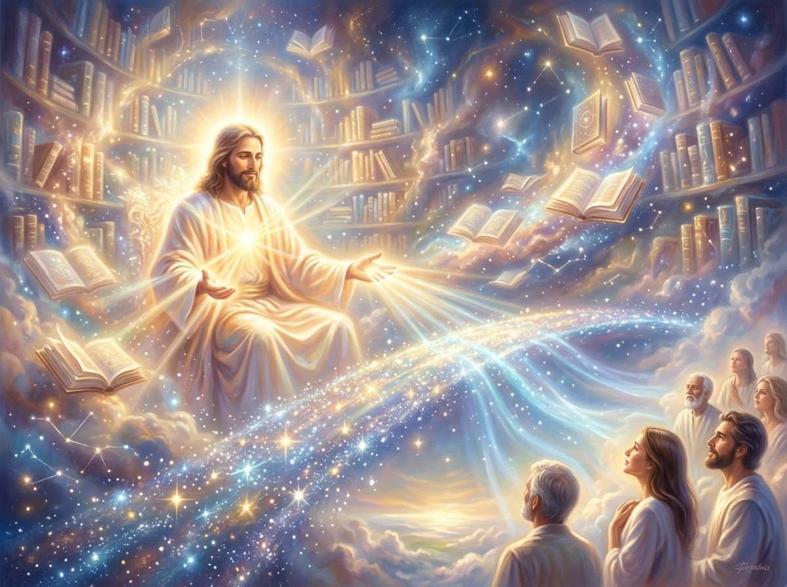

En las Alabanzas en las que he participado los mensajes directos iban en la línea de desarrollar este proyecto, recuerdo especialmente la última en casa de Javier de Cendra en la que un sacerdote impersonando a Jesucristo me dijo que dejara de evitar mi cruz que era bastante más pequeña que la de Él, sintiendo que estos libros, esta comunicación y el rechazo derivado o los miedos a afrontar el rechazo eran esa cruz. Al decirme que era menor entiendo que no me van a crucificar y matarme físicamente por decir y defender un sistema distinto al actual que la Humanidad se resiste a soltar.

Finalmente en Julio de 2025 ante el cuerpo de Carlo Acutis en una conversación muy clara con su consciencia (según mi amiga Cristina podría ser un egregor, pero sea lo que sea tiene mucha potencia y me vale pero yo sentí a ese chico joven muerto con 15 años) Carlo me decía que no me preocupara por algo que en ese momento atormentaba mi conciencia que se iba a quedar en nada pero que cada vez que jugaba, me preocupaba o hacía cualquier cosa no alineada con mi propósito estaba tardando en hacerlo. Claramente sin que me lo dijera me resonó escribir el libro de Democracia.

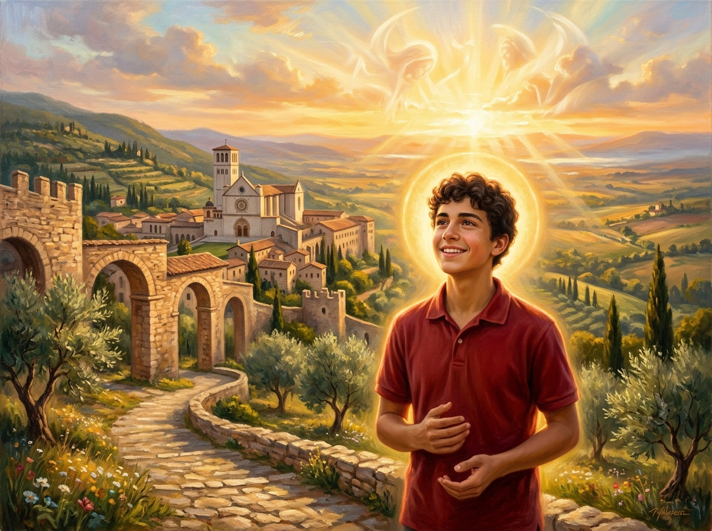

Pero si he escrito este primero por algo será. Todas estas ideas no son mías, son inspiradas. Todo lo que vino desde 2010 era necesario para que llegado este momento no escribiera con el fin de ser importante, de ganar dinero, de ser reconocido, sino desde la Humildad de reconocer que la luz no es nuestra sino que la reflejamos. En terapia diría que Somos esa luz pero esto ya es entrar en Misticismos y no es la idea, la idea es cambiar el foco al Amor, al Servicio, el fin de este libro es Ayudar.

Tuve en enero la conversación con un ferviente católico al que le compré unas ollas de titanio para cocinar sin metales pesados y me dijo que tal como veía el libro a todos los católicos que me criticaran les dijera que hablando del libro y las ideas en Vietnam en vietnamita quizás había evangelizado yo más que muchos católicos de misa los domingos pulcros de cara a la galería, pero que podrían juzgar este libro desde el odio. Ahí dejo las palabras de este ferviente católico que me alivian pero yo ya acepto mi cruz y lo que venga. Dejar en este sentido claramente que el libro en ningún momento defiende el catolicismo, ni siquiera la figura de Jesucristo que bien dijo que cielo y tierra pasarían más sus palabras no pasarían, es la sabiduría eterna lo que trata de llegar a los corazones de católicos y no católicos. El propio Carlo Acutis, ahora Santo, a mi pregunta de por qué estaba ahí me respondió con un simple "me gusta ayudar" sin dar mayor importancia a la ingente cantidad de milagros que se le atribuyen. Solo en el momento en el que nos aligeramos del peso del Ego y con él de la auto importancia podemos conectar con esta fuente llamada Amor.

Tras contar un poco por encima mi trayectoria decir que si Dios quiere publicaré después de Mi Amigo Jesucristo el libro del que estoy hablando sobre el Karma que se fundamenta en el Amor con ejemplos concretos basados en los templos de Vietnam que me dieron la base material de algo de lo que siempre he querido hablar que es el Karma para desmitificarlo más allá de las palabras.

Asimismo y siempre si Dios quiere después quiero publicar el gran libro sobre Democracia basado en mis artículos de 2011 y en estas ideas contenidas en Mi Amigo Jesucristo. También un libro basado en la inocencia del maquinista del accidente del AVE a Santiago de Compostela que ofrezca una visión teórica sobre los Chivos expiatorios, como el propio Jesucristo que mueren para generar cierta paz social temporal derivado de precisamente el karma (o la vuelta del Boomerang de una sociedad matando al inocente). Otra deuda está más vinculada con la Inteligencia Artificial y la robótica desde una perspectiva económica derivado de un escrito de 2016 en el que ya preveía cierta necesidad de cambios económicos serios pero en 2016 cuando lo escribí pensaba que era un pase mental para una generación del siguiente siglo, nunca pensé que en solo 6 años la situación ya estaba cerca de ser real y el problema de una sociedad en la que la mano de obra podría llegar a ser poco necesaria es un problema que si no nos extinguimos antes nuestra generación va a tener que afrontar, asimismo esto presenta un problema de extinción que no pude prever en 2016 y este libro Mi Amigo Jesucristo tiene la llave para evitarlo, una necesaria elevación en la frecuencia de la Humanidad al Amor. Otro libro que también tengo pendiente es sobre la educación basado en un ensayo que me encargó una psicóloga cuando no tenía dinero y que en su momento no me lo pagó con lo cual siempre supe que era importante mantener la propiedad intelectual intacta. Y un par de libros más por ahora, uno que le debo a mi amigo Rafael Enamorado que es la única persona que ha creído en mi proyecto para defender una máquina de producción de agua alcalina y espero que lleve mucha luz a muchos hogares, pero Rafael tuvo fe dentro de una investigación sobre longevidad que probablemente él no pueda terminar pero nos inspire a muchos a continuar. Longevidad es consecuencia de la salud, y de ahí nuestro proyecto de salud del que todo esto es parte. El libro que he escrito junto con Rafael versa sobre una reflexión sobre cómo sería un mundo gobernado por mujeres, pero matiz ahí, un mundo gobernado por energía femenina (la maternidad, el cuidado...) que lo más destacable es que eliminaría la guerra porque no se podría tolerar el ver morir a un hijo... en el fondo resuena con el matiz de Mi Amigo Jesucristo de no caer en la tentación del belicismo, elevar la frecuencia de la guerra a la Paz, del odio al Amor. 

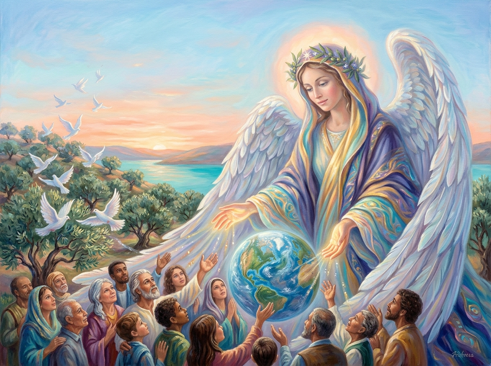

Finalmente voy a publicar un libro que no es mío pero solo en la web de arte de mi madre porque el autor pide la difusión y el mensaje es muy potente, No Soy Markus nos invita a tal y como "A Glimpse of Light" no se manchaba de mis imperfecciones, Markus nos explica que le podemos llamar así pero él no es Markus. Nos invita a saber que como somos ya somos perfectos y siempre lo hemos sido. Al escuchar precisamente a Jesucristo no escuchamos con suficiente atención que somos todos hijos de Dios, no se distinguía judíos de gentiles para él, incluso al decir que nadie era profeta en su tierra mostraba claramente que los gentiles compraban con menos reparos la Buena Nueva, asimismo una y otra vez se ve la idea de que Dios proveerá.

En mi Amigo Jesucristo no he hecho mucho hincapié en esta idea que se marca en el "Danos hoy nuestro pan de cada día" y personas como Markus al demostrar que incluso dejando de comer de alguna forma que la ciencia está aun estudiando sigue proveyendo al cuerpo del alimento. Una vez más sería parte del no caer en la tentación el continuo miedo a no tener y personas como Markus son un ejemplo vivo de que si vibras en Amor incluso aunque lo pierdas todo, todo incluyendo el alimento, Dios te da tu pan, la energía penetra en tus mitocondrias de una forma que no entendemos, o simplemente la ciencia no ha logrado demostrar porque nosotros simplemente usando la fe de la Buena Nueva sabemos que si a los pájaros que viven sin acumular nada Dios les da su alimento todos los días, con cuánta más razón se lo va a dar a los Humanos siempre y cuando estén abiertos a recibirlo.

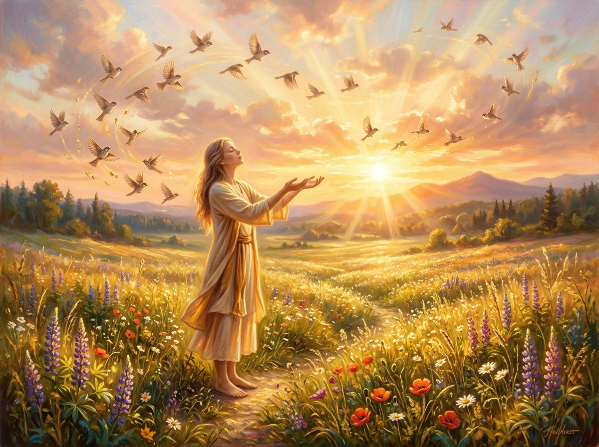

Después Dios dirá, quizás promueva los libros y sus ideas, quizás me dedique a otra cosa. En cualquier caso agradezco a cada lector que si le resuenan estas ideas me ayude a difundirlas y quizás acaben llegando a los grandes centros de decisión y en un mundo cuya geopolítica es un polvorín, donde tenemos el poder de las bombas nucleares, donde tenemos ahora la IA en robots que usados como armas de guerra dejarían en pañales el poder destructivo de las bombas atómicas, quizás si logramos difundir estas ideas penetren en la consciencia humana y podamos subsistir con tanto poder. En caso contrario, ya la Atlántida lo experimentó, el acumular mucho poder y no controlarlo usándolo para el amor simplemente acaba con civilizaciones muy avanzadas.

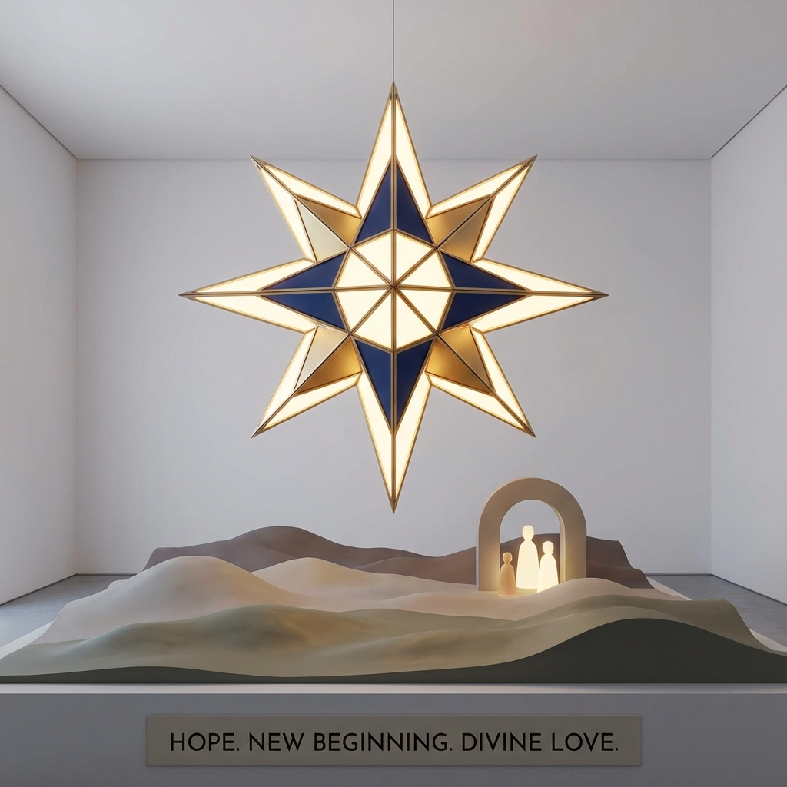

---

### La Misión de la Obra
Por lo tanto *Mi Amigo Jesucristo* propone un redescubrimiento del Maestro libre de dogmas, culpas o ritualismos vacíos. Nos presenta a un Jesús cercano, fresco y contemporáneo, que nos habla de física de partículas, resonancia, campos energéticos y amor incondicional con la misma naturalidad con la que caminaba junto al mar de Galilea o por la Gran Vía de Madrid.

Mi seudónimo representa la convicción de que cada ser humano lleva dentro una chispa inextinguible de la Conciencia Universal. Es ese destello de luz en la oscuridad. Todos lo podemos hacer. El propósito principal de este libro es recordarte que no necesitas intermediarios para conectarte con la Fuente: basta con afinar tu receptor, silenciar el ruido del ego y elegir vibrar en la frecuencia del amor.

---

### Un Agradecimiento de Corazón
Gracias por abrir las páginas de esta obra y por permitir que estas palabras resuenen en tu propio viaje interior. Que este destello de luz te inspire a encender y compartir tu propia verdad en el mundo.

